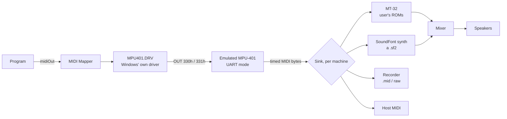

This page is a design for future work. Nothing on it is built.

## Where MIDI goes today

Every MIDI note a program plays ends on the Ad Lib's FM chip. The Ad Lib driver and WinBox's own card, `WBSOUND` ([[topic:sound-devices]]), both drive an emulated OPL2 ([[topic:adlib]]), and the MIDI Mapper's setups name those devices ([[topic:midi-mapper]]). Two things follow:

- **A setup that names another device finds none.** "LAPC1" sends channels 1–10 to the "Roland MPU-401" with the MT-32 patch maps. With no such card it finds no device, as Windows' mapper finds none on a machine without the card.
- **Bytes sent to a MIDI port are not played.** The native build's speaker says so (`crates/winbox-native/src/speaker.rs`): there is nothing to play them on.

Much of the music written for Windows 3.1 was composed for a Roland MT-32 or a General MIDI module, not the Ad Lib. Microsoft's authoring guidelines put an extended arrangement on channels 1–10 for exactly those devices.

## The design in one picture



The machine gets one new piece of hardware: an MPU-401. Windows' own driver, `MPU401.DRV`, drives it, so the path from a program's `midiOutShortMsg` down to the port's bytes is Windows' own, recordable on the oracle. What happens to the bytes on the far side of the port is a **sink**, a plug-in chosen per machine.

## The MPU-401

- **The hardware.** Roland's MPU-401 interface: a data port and a command/status port, at 330h and 331h by default, and an interrupt for input. Windows' driver is expected to use UART mode: reset (FFh), then UART (3Fh), then data bytes passed straight through. What `MPU401.DRV` does is read out of the driver before anything is built: its ports and interrupt, where it reads them from (`SYSTEM.INI`), its status polling, its time-outs, and whether it ever uses the intelligent mode. The emulation follows that read-out, not the MPU-401's manual.
- **Installing it.** As the Sound Blaster was installed on the oracle ([[topic:sound-devices]]): Control Panel's Drivers applet, Windows' own Setup files (`MPU401.DR_` is on the setup disk), and whatever it writes to `SYSTEM.INI`. The machine configuration names the card, and the drive's profiles carry what Control Panel would have written ([[guide:without-windows]]).
- **The MIDI Mapper.** With "Roland MPU-401" present, "LAPC1" finds its device, as on a machine with that card. A General MIDI setup for the MPU-401 is a setup of the user's, made in Control Panel's MIDI Mapper as on Windows. Or the launcher writes it, as Setup's options would.
- **WinBox's own card.** `WBSOUND`'s MIDI port is a second way in. Its bytes go to the same sink, so a machine with WinBox's card and a sink hears the extended arrangement without installing the MPU-401.
- **Timing.** Each byte is stamped with the machine's clock as it is written to the port. A sink is given the bytes in order with their times, never sooner than the machine wrote them. That is the same rule the card's samples follow now (`audio.rs`).

## The sink interface

A sink takes the port's output. It is the same for every kind, so the machine needs to know nothing about what is behind it:

| Call                              | What it is given                                            | Notes                                                                                                                                           |
| --------------------------------- | ----------------------------------------------------------- | ----------------------------------------------------------------------------------------------------------------------------------------------- |
| `open(config)`                    | Its part of the machine configuration                       | Fails with a message the front end shows, such as "MT-32 ROMs not found", and the machine runs with no sink, as a card with nothing plugged in. |
| `bytes(at, data)`                 | MIDI bytes in order with the machine time they were written | Running status, System Exclusive split across writes, and real-time bytes are passed as written. The sink parses them, not the port.            |
| `reset()`                         | —                                                           | The port's reset (FFh), or the machine's.                                                                                                       |
| `render(frames, rate) -> samples` | Asked by the mixer for audio                                | Synthesizers only. A sink with no audio of its own, such as the recorder or host MIDI, gives none.                                              |
| `close()`                         | —                                                           | Flushes a recording, releases a host port.                                                                                                      |

Sinks are Rust modules behind a trait, built into the native build and the wasm build alike. A sink that can't be built for one target, such as host MIDI on a page without Web MIDI, is simply absent there. More than one can run at once: a synthesizer and a recorder, say. The machine fans the bytes out to each.

The synthesizers' audio goes to the speaker's mixer beside the card's samples and the FM chip's. It is added as DOSBox's mixer adds channels, and resampled to the host's rate (`speaker.rs`).

## The sinks

### Roland MT-32

- **What.** An emulation of the MT-32's LA synthesis. Munt (`mt32emu`) is the reference: its output matches the hardware, given the hardware's ROMs. It is C++ under the LGPL. The native build links it, and the page uses a WebAssembly build of it.
- **ROMs.** The MT-32's control and PCM ROMs are Roland's. They are never shipped. The user points the machine at them, a directory or the two files, and the sink identifies them by checksum. That covers MT-32 versions 1.0x and 2.0x, and the CM-32L/LAPC-I with its extra sounds. With no ROMs, or ROMs it doesn't know, `open` fails with a message saying which files were found.
- **Options.** Which of the ROM sets to use when several are present, the output gain, and reverb on or off. Defaults are Munt's.
- **Why.** "LAPC1" is Windows' own setup for this device, and the MT-32 patch maps it uses are in `MIDIMAP.CFG` already.

### SoundFont synthesizer

- **What.** A General MIDI synthesizer playing a SoundFont 2 file. `rustysynth` is a candidate: pure Rust under the MIT licence, building for native and wasm with no C.
- **The SoundFont.** A path to a `.sf2`. WinBox may suggest a freely licensed General MIDI bank, such as GeneralUser GS, but never requires one, and a user's own file, a Sound Canvas–style bank say, is just as welcome. With none given, `open` fails and says so.
- **Options.** Polyphony, gain, the chorus and reverb levels, and the interpolation. The defaults are the synthesizer's.
- **What it is not.** It is no particular 1993 device. Every General MIDI module sounded different, and the result is only as faithful as the bank. The page that offers it says so.

### Recorder

- **What.** Writes what the port played to a file, for checking and for keeping:
  - **raw**: the bytes with their machine times, in the same form as DOSBox's MIDI capture, so the two can be compared byte for byte (see the oracle below);
  - **Standard MIDI File**: a type-0 `.mid` of the same, for listening elsewhere.
- **Options.** The file, and which of the two forms, or both. It runs beside a synthesizer, or alone.

### Host MIDI

- **What.** The bytes passed to a MIDI output of the host's: Windows' GS Wavetable Synth or a hardware interface natively (through a library such as `midir`), and Web MIDI on a page in a browser that has it. A real MT-32 or Sound Canvas on the user's desk is played this way.
- **Options.** Which of the host's outputs, by name. It is not emulation: what it sounds like is the host's.

## A machine's configuration

A machine is the set of things a launcher keeps per program or group of programs ([[guide:without-windows]]): its drive layers, its display, its sound card, and now its MIDI. Its MIDI part:

```json
{
  "midi": {
    "port": "mpu401",
    "sinks": [
      { "kind": "mt32", "roms": "C:/Users/me/MT32", "romSet": "cm32l", "reverb": true },
      { "kind": "recorder", "file": "C:/Users/me/winbox/simtower.mid", "form": "smf" }
    ]
  }
}
```

- `port`: `none`, `mpu401`, or `wbsound` (WinBox's card's own port).
- `sinks`: zero or more, each with its kind's options. A path is the host's, kept by the launcher. On the page it is a file the user chose, kept in the page's storage.

**The native build's flags**, for a run with no launcher:

```
--midi mpu401|wbsound
--midi-sink mt32 --mt32-roms DIR [--mt32-set NAME]
--midi-sink soundfont --soundfont FILE.sf2
--midi-sink record --midi-record FILE.mid|FILE.raw
--midi-sink host [--midi-host NAME]
```

`--midi-sink` may be given more than once. A launcher writes the same configuration as JSON, and the build takes it with `--machine FILE.json`. The flags and the file are one model.

**The page** offers the same choices in its settings: the files are picked by the user and kept in the page's storage, and host MIDI is offered only where the browser has Web MIDI.

## Checking it against Windows

Synthesis can't be checked against a recording of Windows: DOSBox's synthesizers aren't the hardware, and a SoundFont is anyone's. The bytes can.

- **Probes.** The oracle's DOSBox emulates an MPU-401 and can capture the raw MIDI it is sent. A probe plays notes, program changes, System Exclusive and a MIDI file through MCI and through `midiOut*`, on `MPU401.DRV`, under each MIDI Mapper setup. The recording is the bytes in order. Their times are compared to within the machine's clock, as the corpus compares timing ([[topic:timing]]).
- **Both engines** produce the same bytes from the same program. That is the port and the driver checked, whatever sink is behind them.
- **The MT-32 sink** is trusted to Munt's own fidelity. It is not something this project can measure.

## The order of the work

1. **Read out `MPU401.DRV`** and record the probes: what it writes, under each setup.
2. **The MPU-401 port** in both engines, with the recorder sink, until the bytes agree with DOSBox's.
3. **The SoundFont sink**, since it needs nothing of Roland's or Microsoft's, and the mixer that adds its audio to the speaker's.
4. **The MT-32 sink**, with ROM identification.
5. **Host MIDI**, native, then Web MIDI.
6. **The machine configuration** in the native build (`--machine`) and the page's settings, ready for the launcher.

## Not yet done

All of it.
